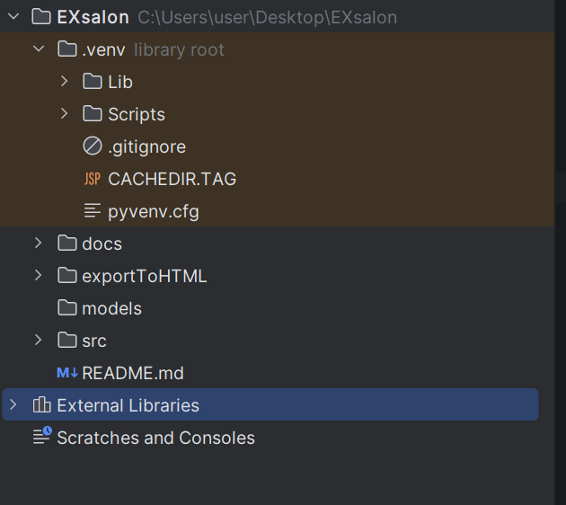
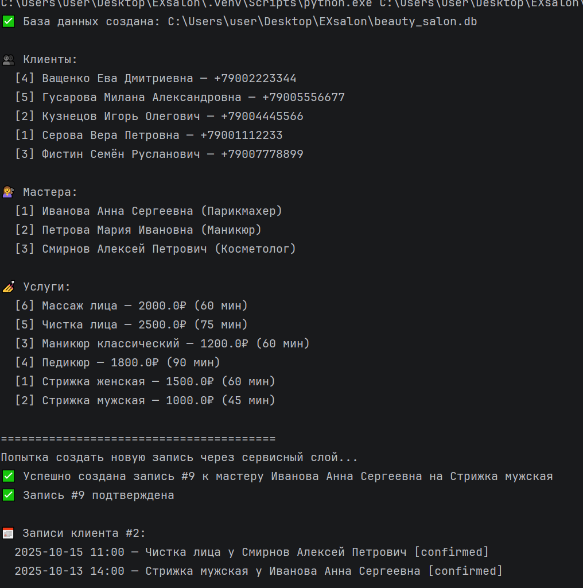
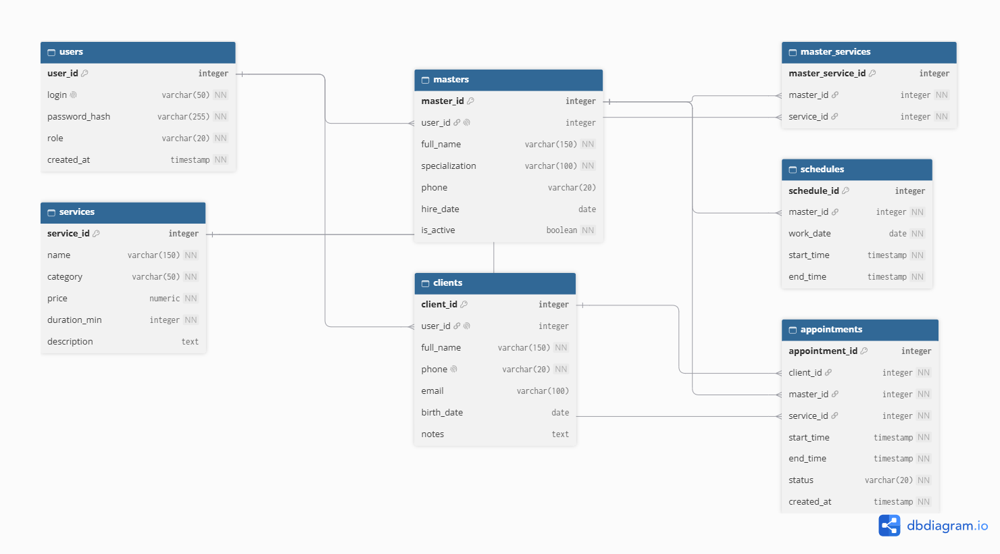

# О проекте
### Учебный проект для лаболаторной работы №2 на Python.
Программа позволяет вести учет оказываемых услуг, управлять расписанием мастеров и базой клиентов. Основная задача системы — избавить администратора от рутинной работы с бумажными журналами, предоставить клиентам возможность самостоятельной записи, а мастерам — удобный доступ к своему графику.

### Ключевые возможности:

Ведение базы клиентов (ФИО, история посещений).

Управление расписанием мастеров (график работы, занятые слоты).

Создание, подтверждение и отмена записей на услуги.

Разграничение прав доступа в зависимости от роли пользователя.

 ### Описание предметной области
Предметной областью является деятельность салона красоты, оказывающего услуги населению (стрижки, маникюр, косметология и т.д.).
В системе учитывается:

Данные клиентов: ФИО, контактные данные.

Расписание мастеров: График работы, доступные временные слоты.

Записи: Информация о том, кто, к какому мастеру и на какую услугу записан.

### Цели разработки
Повышение лояльности клиентов за счет удобства сервиса.

Упрощение работы администратора (быстрый поиск свободного окна, автоматизация рутины).

Ведение истории посещений клиентов для анализа популярности услуг.

### Основные функции системы
Для Клиента: Просмотр прайса, просмотр свободного времени мастеров, создание заявки на запись, отмена записи.

Для Администратора: Создание и удаление записи, поиск клиента по базе, регистрация нового клиента, управление пользователями.

Для Мастера: Просмотр личного графика на день.

### Архитектура и способы реализации
Архитектура: Клиент-серверная

Серверная часть: Язык программирования Python

 ## Типовая структурв проекта

## Запуск 
Python scr/main.py

## Автор 
Самарина Дана Георгиевна 

### Use case диаграмма


# Салон красоты — База данных

## Описание предметной области
Учёт услуг салона красоты, управление расписанием мастеров,
база клиентов и запись на услуги.

## ER-диаграмма



## Структура БД

| Таблица | Назначение |
|---------|-----------|
| users | Учётные записи и роли |
| clients | Профили клиентов |
| masters | Профили мастеров |
| services | Прайс-лист услуг |
| master_services | Какие услуги оказывает мастер (M:N) |
| schedules | График работы мастеров |
| appointments | Записи клиентов |

### Работа Программы

## Запуск

```bash
python main.py

